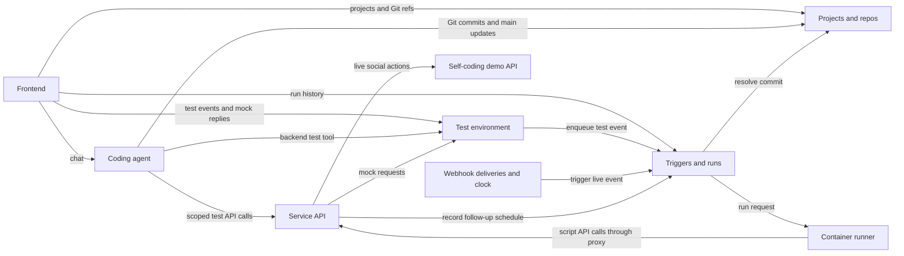

# Self-coding project demo

A customer describes an automation in chat. A coding agent writes Git commits and chooses any commit for a test run. The tip of main is always live. Moving main selects the code for new live workflows.

Webhooks and schedules queue runs. A container runs the selected commit and calls the service API through a proxy. The script saves conversation state before it exits. A later DM starts a new run at the workflow’s original commit, even after main changes.



The two loops go through the run queue. A test event starts a run that can produce a mock prompt. A script can record a follow-up schedule that starts a later run. Both requests return once the backend records them. If event intake waits for the run to finish, a mock prompt can stall the browser request that started the run.

Backend chat tools coordinate the existing components. They execute outside the coding container and retain actual test and deployment results.

The frontend touches four components because it presents four tasks. Projects owns Git refs, Triggers owns run status, and Test owns fixtures and prompts.

[Product concept](CONCEPT.md)

[Projects and repos](docs/projects.md) · [Triggers and runs](docs/runs.md) · [Container runner](docs/runner.md) · [Service API](docs/service-api.md) · [Test environment](docs/testing.md) · [Coding agent](docs/coding-agent.md) · [Frontend](docs/frontend.md)

## Run the prototype

Use Python 3.12 or later, Git, Docker, and uv.

```sh
docker pull python:3.12-alpine
uv sync --locked
uv run --locked uvicorn app.main:create_app --factory --port 18765
```

Open [the local app](http://127.0.0.1:18765). With coding chat enabled, create a project and ask the agent to build, test, and deploy an automation in English.

The manual controls also support tests. Add the example commit on its Git branch. Start a test, send a pricing comment, and answer the two mock requests. Then send a DM with an email address and answer the final mock request. Move main to the selected commit and use **Live debug** to exercise the webhook path with the demo social adapter.

To enable coding chat, install the runtime and build its worker image. The worker uses a file-based Codex CLI login.

```sh
uv pip install --python .venv/bin/python -r requirements-agent.txt
docker build -t self-coding-codex-worker:0.3.0 agent-image
export SELF_CODING_CONTROL_KEY="$(openssl rand -hex 24)"
printf 'Open http://127.0.0.1:18765/?key=%s\n' "$SELF_CODING_CONTROL_KEY"
SELF_CODING_CODEX_IMAGE=self-coding-codex-worker:0.3.0 uv run --locked uvicorn app.main:create_app --factory --port 18765 --no-access-log
```

The browser key gives the local browser access to project controls. The coding worker receives a separate URL for its mock session.

Use a trusted Docker worker for Codex because the worker handles a Codex login. The default login comes from the local Codex CLI. Set `SELF_CODING_CODEX_AUTH` to use a separate file-based login. On Linux, set `SELF_CODING_CODING_TEST_ORIGIN` to the app origin that the coding worker can reach.

The local app uses one demo profile and SQLite. Its live debug adapter simulates the assumed Self-coding demo API. The app binds to loopback and is for local use.

## Contributions

The project author supplied the product concept and requirements, including Git-backed projects, interactive mock responses, and commit pinning across replies. Codex wrote the component contracts and implementation, and ran the checks. Separate Codex chats implemented the components.
